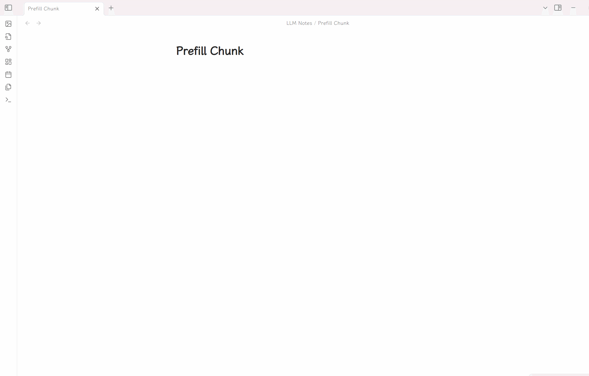
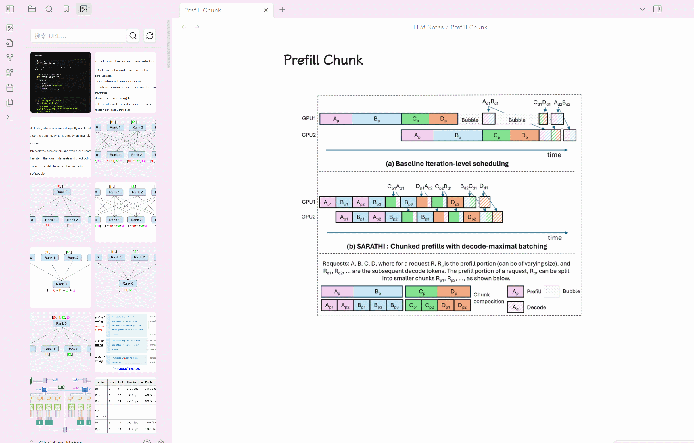
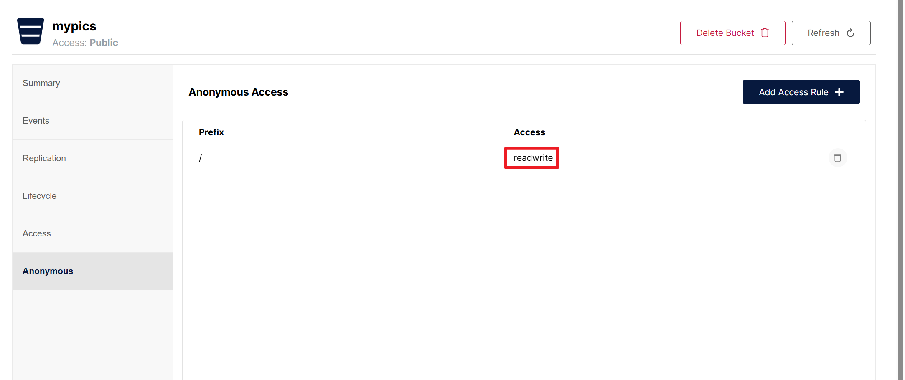

# Obsidian OSS Gallery 插件

### [English](./README.md) | 中文

这个插件可以把 Obsidian 中的文件上传到多个对象存储服务，并为支持列举对象的服务提供图库视图。

> **要求**：Obsidian 1.7.2 或更高版本。

> **注意**：本插件仅支持桌面端。它依赖 Obsidian 移动端不具备的 Node.js 能力（crypto 签名、本地文件系统）。

项目最初 fork 自 [Obsidian Minio Uploader Plugin](https://github.com/seebin/obsidian-minio-uploader-plugin)，目前已经扩展为多 provider 架构。

## 支持的存储服务

- **本地存储**：仅桌面端可用的本地文件管理，支持图库预览、删除到回收站
- **SM.MS**：图床
- **GitHub**：上传到仓库
- **阿里云 OSS**
- **腾讯云 COS**
- **七牛 Kodo**
- **又拍云 USS**
- **Imgur**：仅支持图片上传，不支持图库列举和删除
- **Cloudflare R2**：S3 兼容对象存储
- **S3**：通用 S3 兼容提供商（AWS S3、DigitalOcean Spaces、Backblaze B2 等）
- **MinIO**：自托管 S3 兼容对象存储

## 功能

- 支持命令面板上传（可一次选择多个文件）、粘贴上传、拖拽上传
- 笔记中显示上传进度卡片：可取消正在上传或等待中的文件；上传失败时文件保留在笔记中，可重试、保存到仓库（作为普通附件）或移除
- 支持的文件类型：图片、视频、音频、`.doc`、`.docx`、`.pdf`、`.pptx`、`.xls`、`.xlsx`
- 支持全局对象命名规则和路径规则
- 支持全局基础路径前缀
- 支持图片、视频、音频、文档的插入/预览配置
- 对支持列举的 provider 提供图库视图
- 支持普通文本搜索和正则搜索
- 一键复制链接、复制为嵌入（按你的嵌入格式）、插入到最近的笔记，或把图片拖进笔记直接插入嵌入
- 对支持删除的 provider 可直接在图库中删除
- 多选（Ctrl/Cmd 点击、Shift 点击、Ctrl/Cmd+A，Esc 取消），可批量复制链接 / 嵌入、插入和删除
- 网格支持键盘操作（方向键、Home/End、Enter 预览、菜单键打开操作）
- 图片全屏预览：缩放（滚轮、双指捏合、双击、+/-/0/1）、适应屏幕 / 适应宽度 / 100%、拖动平移、上一张/下一张按钮、方向键或滑动切换，以及复制 / 删除 / 查找相似图片
- 图库包含懒加载、分批渲染、回到顶部和后台刷新
- 本地图库缩略图：每张图片只下载一次，之后显示本机保存的小缩略图（有容量上限，不依赖语义搜索）
- 可选的本地语义图片搜索：按描述或相似度查找图片（需要 WebGPU，模型按需下载，见[下文](#语义图片搜索可选)）

---

## 设置

先在插件设置里选择当前启用的 provider，再配置下面两类设置。

### 全局设置

- **Base path**：所有上传对象统一追加的前缀路径；图库只列出该路径（以及服务商自身的路径前缀，如有）下的文件
- **命名规则**
  - `local`
  - `time`
  - `timeAndLocal`
- **路径规则**
  - `root`
  - `type`
  - `date`
  - `typeAndDate`
- **插入的链接**（上传后写入笔记的内容）
  - 嵌入图片开关（关闭则插入普通链接）；开启时显示图片嵌入格式
  - 以播放器嵌入视频 / 音频的开关
  - 文档预览服务：禁用（普通链接）、Google Docs、Office Online
- **存储服务配置**：服务列表标出仅上传和尚未配置的存储服务；必填项带标记，并有一行列出缺少的字段。**测试连接** 用一次只读的小请求检查设置（列出一个文件，不上传任何内容）。仅上传的存储服务（Imgur）只能通过上传来检查。
- **图库缩略图**（默认开启，与语义搜索无关）
  - 图库瓦片第一次显示时，原图只下载一次（通过 Obsidian 自带的请求接口；Local 直接读磁盘文件）并显示，同时在本机、仓库之外保存一张小缩略图（最长边 320 px，WebP）：Windows `%LOCALAPPDATA%\obsidian-oss-gallery\thumbs`，macOS `~/Library/Application Support/obsidian-oss-gallery/thumbs`，Linux `~/.cache/obsidian-oss-gallery/thumbs`。之后再显示时直接用缩略图，不再下载。建立语义索引时也会顺带保存缩略图。
  - 预览、**复制链接** 和嵌入始终使用原图。动图 GIF 和 SVG 照旧加载原图；TIFF 只有在建立索引时生成过缩略图才会显示。
  - **缩略图缓存上限**（默认每个 vault 在本机 500 MB）：超出后删除最久未查看的缩略图。
  - **清除缩略图** 只删除缩略图文件，不影响语义索引和模型（它们的操作也不会动缩略图）。关闭缩略图后图库与以前完全相同，直接加载原图。
- **语义搜索**：模型下载 / 校验 / 删除、模型目录、索引目录、识别精细度、自动建立索引、索引状态与清除（见[语义图片搜索](#语义图片搜索可选)）

### Provider 设置

#### 本地存储

- 仅支持 Obsidian 桌面端
- 存储路径：仓库相对路径，或会插入为 `file:///` 链接的绝对路径
- 使用仓库相对路径：开关（默认开启，仅支持本地文件仓库）
- 删除到回收站：删除文件时移到系统回收站（默认开启）

#### SM.MS

- S.EE API Key（SM.MS 已迁移至 S.EE，请在 S.EE 的 **工具 > API Token** 中创建）

#### GitHub

- 仓库：`owner/repo`
- 分支
- Personal Access Token
- 自定义 URL：可选，适合 jsDelivr 等 CDN

#### 阿里云 OSS

- Access Key ID
- Access Key Secret
- Bucket
- Region，例如 `oss-cn-hangzhou`
- 路径前缀：可选
- 自定义域名：可选

#### 腾讯云 COS

- Secret ID
- Secret Key
- Bucket
- Region，例如 `ap-shanghai`
- 路径前缀：可选
- 自定义域名：可选

#### 七牛 Kodo

- Access Key
- Secret Key
- Bucket
- CDN 域名 URL
- 存储区域
- 路径前缀：可选

#### 又拍云 USS

- 操作员名称
- 密码
- 服务名称
- 加速域名 URL
- 路径前缀：可选
- 图片处理后缀：可选

#### Imgur

- Client ID
- Proxy URL：可选，部分地区需要

注意：Imgur 目前只支持上传图片文件，不支持图库列举和删除。

#### Cloudflare R2

- Account ID
- Access Key ID
- Secret Access Key
- Bucket
- Public URL：自定义域名或 `r2.dev` 地址

#### S3（通用）

- Endpoint：S3 兼容端点（例如 `s3.amazonaws.com`）
- Region
- Access Key ID
- Secret Access Key
- Bucket
- 使用 SSL：开关（默认开启）
- 强制路径风格：使用 `endpoint/bucket/key` 而非 `bucket.endpoint/key`（默认开启）
- Public URL：可选，自定义文件访问 URL

#### MinIO

- Endpoint：主机名或完整 URL；显式填写的 `http://` / `https://` 协议和端口优先
- Port：Endpoint 为未指定端口的主机名时使用
- Use SSL：Endpoint 未包含 URL 协议时使用
- Access Key
- Secret Key
- Bucket
- Region：可选
- 自定义域名：可选

如果要让 MinIO 返回的链接可直接访问，需要在 Bucket 策略中开放匿名访问或提供公开可访问的对象 URL。

## 语义图片搜索（可选）

语义搜索可以用中文或英文描述来查找图片，也可以查找与某张图相似的图片。**默认关闭**，在你确认之前不会下载任何文件。

**快速上手：** **设置 → 语义搜索 → 下载模型** → 打开图库 → 点击搜索框下方的 **建立索引** → 打开搜索框旁的 ✨ 开关，输入描述（例如“沙发上的猫”）并按 **回车**。

- **要求：** 桌面版 Obsidian，支持 **WebGPU** 且有硬件 GPU（核显即可）。设置页会先检测，并说明不可用的原因（Obsidian 或显卡驱动过旧、远程桌面 / 虚拟机、只有软件渲染器）。没有 CPU 回退。
- **下载：** 约 **343 MB**，只有在 **设置 → 语义搜索 → 下载** 中确认文件清单后才开始：
  - 运行时（约 27 MB）：`semantic-worker.js` 与 ONNX Runtime WebAssembly 文件，来自本插件的 GitHub Release
  - 模型（约 316 MB）：[EmbeddingGemma 2](https://huggingface.co/onnx-community/embeddinggemma-2-ONNX) 文本与视觉编码器（q4），来自 Hugging Face 的固定版本
  - 每个文件使用前都会用插件内置的 SHA-256 校验；下载中断后按文件续传
- **存放在仓库之外**，本机所有仓库共用，不会被同步：
  - Windows：`%LOCALAPPDATA%\obsidian-oss-gallery\models`
  - macOS：`~/Library/Application Support/obsidian-oss-gallery/models`
  - Linux：`$XDG_CACHE_HOME/obsidian-oss-gallery/models`（默认 `~/.cache/...`）
  - 可在 **模型目录** 中修改（绝对路径）
- **删除：** **删除模型** 只删除插件下载的文件（以及因此变空的目录），不会动目录中的其他文件。使用同一目录的所有仓库都会受影响。
- **下载源（可选）：** 下载使用 Node 的 HTTPS 客户端，**不会**走系统代理。如果你所在地区无法访问或访问 Hugging Face / GitHub 较慢（例如中国大陆），可在 **设置 → 语义搜索 → 下载源** 中设置：
  - **Hugging Face 地址**：替换模型文件的 `https://huggingface.co`。镜像需提供相同的 `/<repo>/resolve/<revision>/<file>` 路径，例如 `https://hf-mirror.com`。
  - **GitHub 镜像**：运行时文件的代理前缀，完整的 GitHub 地址会拼接在其后：填写 `https://gh-proxy.com` 时实际请求 `https://gh-proxy.com/https://github.com/stmoonar/oss-gallery-plugin-obsidian/releases/download/<版本>/<文件>`。
  - 只接受 `https://` 地址（末尾的 `/` 会被去掉）。留空使用官方站点。
  - 镜像无法改变安装的内容：每个文件仍必须与插件内置的 SHA-256 一致，下载对话框会显示实际连接的主机。修改镜像不影响已安装的文件。
  - 如果没有可用的镜像，可以使用下面的离线安装。
- **离线安装：** 按相同结构把文件复制到模型目录（`huggingface.co/onnx-community/embeddinggemma-2-ONNX/resolve/<revision>/...` 与 `runtime/<插件版本>/...`），然后点 **校验** 或 **下载**：通过哈希校验的文件会被保留，不会重新下载。
- **设置项：** 模型安装前只显示 WebGPU 检查、下载源和下载按钮；模型目录与索引目录在 **高级** 中。下载模型时状态栏显示“正在下载模型 42%”（点击打开设置）。安装后：识别精细度（70/140/280，即模型看每张图片时使用的图像 token 数，默认 70；之后修改会先确认，因为会重建索引，远程图片需要重新下载）与自动建立索引。
- **建立索引：** 所有支持列表的图床都可以建立索引（Imgur 除外）。在图库中点击 **建立索引** / **更新索引（N 张新图片）**（或运行 **语义搜索：立即为当前存储服务建立索引**）。进行中时图库顶部的进度条显示数量、当前文件、暂停 / 继续与停止；状态栏显示同样的计数，例如“正在索引 12/80 · 点击暂停”（点击暂停 / 继续）。停止后已完成的部分保留，下次继续。
  - **本地** 图床直接读取磁盘文件：不产生网络流量，也不需要确认。
  - **远程图床** 需要把每张图片下载一次并在本机分析。开始前一定会弹出对话框，显示图片数量、需下载的大小和已有索引的数量。开启 **自动建立索引** 后，图库刷新时会为新图片建立索引；每台设备第一次会询问，之后只有需下载超过 200 MB 时才会再次询问。
  - 图片通过 Obsidian 自带的请求接口下载（不需要配置存储桶 CORS，会走系统代理），地址与图库显示的相同。**私有** 的 S3 / R2 / MinIO 存储桶在公开地址被拒绝时改用签名请求。仍无法读取的图片（例如私有的阿里云 / 腾讯云 / 七牛存储桶）会标记为“失败”，原因为“拒绝访问：请检查存储桶权限”。
  - 通过插件上传的图片直接用手头的文件建立索引（不重新下载）；在图库中删除的图片立即移出索引；在别处删除的图片会在下一次完整列表时从结果中隐藏，第二次时彻底清除。
  - **索引文件** 按设备存放在仓库之外，不会同步（每台设备各自建立索引）：Windows `%LOCALAPPDATA%\obsidian-oss-gallery\indexes`，macOS `~/Library/Application Support/obsidian-oss-gallery/indexes`，Linux `~/.cache/obsidian-oss-gallery/indexes`。可在 **索引目录** 中修改；**清除本仓库的索引** 只删除本仓库的索引文件。删除模型不会影响索引，反之亦然。
  - **缩略图：** 图片被索引时顺带保存它的[图库缩略图](#全局设置)（不产生额外下载；TIFF 也能因此显示真实缩略图）。**清除本仓库的索引** 保留缩略图，**清除缩略图** 保留索引。
- **图片格式：** JPEG、PNG、WebP、GIF（第一帧）、BMP、ICO、AVIF 直接读取。**SVG** 会先栅格化（不会执行脚本或加载外部资源），**TIFF** 用内置的 [UTIF.js](https://github.com/photopea/UTIF.js)（MIT）解码，二者标记为“经转换”。HEIC/HEIF、PSD、相机 RAW 与无法识别的文件标记为“不支持”并跳过。图库也会列出 `.avif` 文件。
- **搜索：** 搜索框旁的 ✨ 开关切换到语义模式（在模型安装完成且当前图床已有索引之前不可用，提示中会说明原因；语义模式下正则开关不可用）。输入描述后按 **回车**，图库先显示最佳匹配（12 到 60 张，取决于最高分与其余图片拉开的差距），按相似度从高到低排列，每张图左下角显示一个小分数；网格末尾的 **显示更多** 按同样的顺序每次再加 60 张相似度较低的图片。第一次搜索需要加载搜索模型（约 1.5 秒）。按 **Esc**、清除按钮或 **×** 返回全部图片。分数只用于排序，没有固定阈值。
- **找相似图片：** 右键点击图片（或使用悬停按钮）→ **找相似图片**，图库显示与它最接近的图片，标题为“与 *文件名* 相似 ×”，最相似的在前，其余可通过 **显示更多** 查看。
- **文字搜索** 时搜索框下方显示一行小字，例如“12 / 552 张图片”；不搜索时不显示数量。
- **索引状态：** 有新图片待索引或有失败项时，搜索框下方显示类似“已索引 1,234 张 · 3 张已转换 · 2 张失败”的标签（全部索引完成后隐藏）。点击查看详情：经转换的文件（含原格式）以及不支持 / 失败的文件和原因；点击文件名可在图库中定位，也可 **重试失败的图片**。没有任务进行时状态栏不显示内容。设置页显示同样的统计和列表。两处都会显示索引在磁盘上的大小（当前存储服务的；若其他存储服务也有索引，另显示本仓库合计），正好是 **清除本仓库的索引** 会删除的文件。
- **自检：** 模型安装后，在命令面板运行 **语义搜索：运行自检**。它会在 GPU 上加载模型，对几条测试查询、一张生成的测试图片以及仓库中最多两张图片（优先当前打开的图片）计算向量，并显示加载时间、延迟与相似度表。所有数据都不会离开本机；模型从模型目录离线运行。
- **第三方许可：** 运行时打包了 [transformers.js](https://github.com/huggingface/transformers.js)（Apache-2.0）、ONNX Runtime Web（MIT）、UTIF.js 与 pako（MIT/Zlib）及它们的少量依赖。许可证全文见每个 GitHub Release 中与 `semantic-worker.js` 一起发布的 `THIRD_PARTY_NOTICES.txt`。

## 网络使用与隐私

本插件只会向你配置的存储服务发起网络请求（若你选择下载语义搜索模型，另会访问 GitHub 与 Hugging Face，或你设置的镜像），不含遥测、统计或广告，也不会向插件作者发送任何数据。

- **文件会发送到你选择的服务。** 上传、列表、删除会访问当前 Provider 的端点：
  - S3（通用） / MinIO：你填写的 Endpoint（MinIO 按配置使用 `http://` 或 `https://`）
  - Cloudflare R2：你的 R2 S3 端点（`<account>.r2.cloudflarestorage.com`）
  - 阿里云 OSS：`<bucket>.<area>.aliyuncs.com`（或自定义域名）
  - 腾讯云 COS：`<bucket>.cos.<region>.myqcloud.com`
  - 七牛 Kodo：`up-<area>.qiniup.com` 及七牛 API 域名
  - 又拍云 USS：`v0.api.upyun.com`
  - GitHub：`api.github.com`（链接默认使用 `raw.githubusercontent.com`，设置自定义域名后则使用你的域名）
  - Imgur：`api.imgur.com`，或你配置的代理
  - SM.MS（通过 S.EE）：`s.ee/api/v1`
  - 本地存储：不联网
- **文档预览。** 若将文档预览服务设为 Google Docs 或 Office Online，文档的公网 URL 会被发送到 `docs.google.com/viewer` 或 `view.officeapps.live.com` 以便渲染。保持“禁用”即可避免。
- **账号与费用。** 除本地存储外，每个 Provider 都需要你自己的账号（或自建服务）。部分服务是收费的，请查看各服务的定价。
- **仓库之外的本地文件。** 本地存储支持绝对路径。该模式下插件会读取、写入并（可选）把文件移入系统回收站，这些文件位于仓库之外，因为画廊需要列出并管理你指定的目录。插件只操作该目录。
- **图库缩略图。** 图库瓦片从你的存储服务下载每张图片一次（与以前相同，但改用 Obsidian 的请求接口），并在本机、仓库之外保存小缩略图，之后显示不再下载。可在 **图库缩略图** 中关闭，恢复直接加载图片。
- **语义图片索引（需主动开启）。** 为远程图床建立索引时，会从该存储服务下载图片，且只在你确认流量估算之后进行。图片在本机分析，不会上传任何内容。
- **语义搜索模型（需主动开启）。** 只有在你确认下载对话框后，插件才会从 `github.com`（本插件的 Release，由 `release-assets.githubusercontent.com` 提供）和 `huggingface.co`（由其 CDN 提供）下载文件（若在 **下载源** 中设置了镜像，则从镜像下载），并写入仓库之外的模型目录。图片和搜索词不会被发送到任何地方；模型在你的 GPU 上本地运行。
- **凭据以明文保存。** Access Key、Token、Secret 会明文保存在仓库 `.obsidian/plugins/` 下插件的 `data.json` 中。如果你同步或提交仓库（Git、网盘），请排除该文件，或使用最小权限的密钥。
- **无遥测。** 插件不收集使用数据或崩溃报告。
