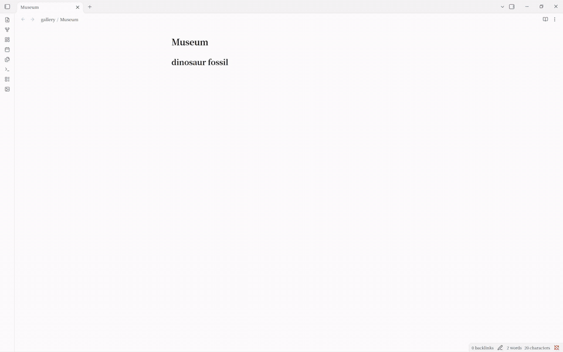

# OSS Gallery for Obsidian

### [English](./README.md) | 中文

把 Obsidian 中的图片、视频、音频和文档上传到你自己的存储（S3、R2、MinIO、阿里云、腾讯云、七牛、又拍云、GitHub、SM.MS、Imgur 或本地文件夹），在图库中浏览，并可选地在本机用文字描述搜索图片。

  

## 快速开始

1. 安装并启用插件（见[安装](#安装)）。
2. 在 **设置 > OSS Gallery** 的 **选择存储服务** 中选一个服务，填好标有 **必填** 的字段。
3. 点击 **测试连接**。
4. 把文件粘贴或拖进笔记即可上传。通过左侧边栏的 **OSS 图库** 图标或命令 **打开图库** 打开图库。

## 安装

- **社区插件**（推荐）：在 **设置 > 第三方插件 > 浏览** 中搜索 “OSS Gallery”，或打开[插件页面](https://community.obsidian.md/plugins/oss-gallery)点击 **Add to Obsidian**。
- **手动安装**：从[最新 Release](https://github.com/stmoonar/oss-gallery-plugin-obsidian/releases) 下载 `main.js`、`manifest.json`、`styles.css`，放到 `<仓库>/.obsidian/plugins/oss-gallery/`，然后启用插件。
- 语义搜索的运行时文件不随插件安装，而是在你确认后由插件下载到模型目录，来源是 tag 与插件版本号一致的 GitHub Release。没有对应 Release 的版本（本地开发构建，或 BRAT 安装的未发布版本）无法下载运行时。
- 仅支持桌面端。需要 Obsidian **1.7.2** 或更高版本，不支持更旧的版本。

## 功能

- **上传**：粘贴、拖拽，或命令 **选择文件上传**（可一次选多个文件）。支持图片、视频、音频、PDF 和 Office 文件（`.doc`、`.docx`、`.pptx`、`.xls`、`.xlsx`）。文件逐个上传；笔记中的进度卡片可以取消正在上传或等待中的文件。上传失败时文件保留在笔记中，可 **重试**、**保存到仓库**（作为普通附件）或 **移除**。
- **插入的链接**：按文件类型插入嵌入或普通链接，图片嵌入格式可自定义。
- **图库**（仅限能列出文件的存储服务）：只显示图片文件（`.jpg`、`.jpeg`、`.png`、`.gif`、`.bmp`、`.webp`、`.svg`、`.ico`、`.tiff`、`.tif`、`.avif`）。按链接搜索（普通文本或正则）、**复制链接**、**复制为嵌入链接**、**插入到笔记**、把图片拖进笔记、删除。
- **多选与键盘**：Ctrl/Cmd 点击、Shift 点击、Ctrl/Cmd+A、Esc；方向键、Home/End、Enter 预览。可批量复制、插入和删除。
- **大图预览**：缩放（滚轮、双指捏合、双击、`+`/`-`/`0`/`1`）、适应屏幕 / 适应宽度 / 实际大小（100%）、拖动平移、上一张/下一张、滑动切换。
- **本地缩略图**：图库中每张图片只下载一次，之后显示本机保存的小缩略图。见[设置](#gallery-thumbnails)。
- **语义图片搜索**（需主动开启）：按描述或相似度查找图片，在你的 GPU 上运行。见[下文](#语义图片搜索)。

## 存储服务

| 存储服务 | 上传 | 图库 | 删除 | 语义搜索 | 私有存储桶（签名 GET） | 说明 |
| --- | --- | --- | --- | --- | --- | --- |
| Local | 是 | 是 | 是 | 是 | 不适用 | 仓库内目录，或绝对目录（以 `file:///` 链接插入） |
| SM.MS | 是 | 是 | 是 | 是 | 否 | 使用 S.EE API（SM.MS 已迁移到 S.EE） |
| GitHub | 是 | 是 | 是 | 是 | 否 | 未设置 **自定义域名** 时链接使用 `raw.githubusercontent.com` |
| Aliyun OSS | 是 | 是 | 是 | 是 | 否 | |
| Tencent COS | 是 | 是 | 是 | 是 | 否 | |
| Qiniu | 是 | 是 | 是 | 是 | 否 | **访问域名**（CDN 域名）必填 |
| Upyun | 是 | 是 | 是 | 是 | 否 | **访问域名**（加速域名）必填 |
| Imgur | 是 | 否 | 否 | 否 | 否 | 仅上传，仅图片 |
| Cloudflare R2 | 是 | 是 | 是 | 是 | 是 | |
| S3 | 是 | 是 | 是 | 是 | 是 | AWS S3 及 S3 兼容服务 |
| MinIO | 是 | 是 | 是 | 是 | 是 | 需要公开链接时，在存储桶策略中允许匿名读取 |

签名 GET：对于私有的 S3 / R2 / MinIO 存储桶，公开地址被拒绝时，图库缩略图和语义索引会改用签名请求再试一次。笔记中的链接和大图预览始终使用公开地址。

字段（`*` 为必填，括号内为默认值）：

| 存储服务 | 字段 |
| --- | --- |
| Local | 存储路径*（`attachments`）、使用仓库相对路径（开）、删除到回收站（开） |
| SM.MS | S.EE API Key*（在 S.EE 的“工具 > API Token”中创建） |
| GitHub | GitHub 仓库名*（`用户名/仓库名`）、分支（`main`）、访问令牌*、自定义域名 |
| Aliyun OSS | Access Key ID*、Access Key Secret*、存储桶*、区域（`oss-cn-hangzhou`）、路径前缀、自定义域名 |
| Tencent COS | Secret ID*、Secret Key*、存储桶*、区域（`ap-shanghai`）、路径前缀、自定义域名 |
| Qiniu | Access Key*、Secret Key*、存储桶*、访问域名*、存储区域（`z0`）、路径前缀 |
| Upyun | 操作员*、密码*、存储桶*（服务名称）、访问域名*、路径前缀、处理后缀 |
| Imgur | Client ID*、代理 |
| Cloudflare R2 | 账户 ID*、Access Key ID*、Secret Access Key*、存储桶*、公开访问地址 |
| S3 | Endpoint*、区域（`us-east-1`）、Access Key ID*、Secret Access Key*、存储桶*、使用 SSL（开）、强制路径风格（开）、公开访问地址 |
| MinIO | Endpoint*、端口（`9000`）、使用 SSL（开）、Access Key*、Secret Key*、存储桶*、区域、自定义域名 |

**路径前缀** 是存储服务内的目录前缀。MinIO 的 **端口** 和 **使用 SSL** 只在 **Endpoint** 没有 `http://` / `https://` 前缀时生效。

## 设置

按设置页中的顺序：

1. **选择存储服务**：仅上传和未配置的服务会标出。下面是该服务的字段、一行 “缺少：...” 提示和 **测试连接**（Imgur 只能通过上传来检查）。
2. **上传路径与文件名**
   - **基础路径**：上传文件的目录；图库只列出此路径下的文件。
   - **命名规则**：本地文件名 / 时间戳 / 时间戳 + 本地文件名（默认）。原文件名易读，但可能覆盖存储中的同名文件；时间戳可以避免。
   - **路径规则**：根目录（不分子目录）（默认） / 按文件类型划分目录 / 按日期划分目录 / 按文件类型 + 日期划分目录。
3. **插入的链接**
   - **嵌入图片**（开；关闭则插入普通链接）和 **图片嵌入格式**：`$URL` 表示图片地址，`$NAME` 表示文件名。默认 ``；Wiki 链接示例 `![[$NAME]]`。
   - **嵌入视频**、**嵌入音频**（开）：以播放器插入。
   - **嵌入文档**：禁用（默认） / Google Docs 预览 / Office Online 预览，用于 PDF 和 Office 文件（文件地址必须公开）。
4. **图库缩略图**
   - **本地缩略图**（开）：图片第一次在图库显示时，原图只下载一次，并在本机保存一张小缩略图（320 px，WebP）。预览、复制和嵌入始终使用原图。GIF 和 SVG 照旧加载原图；TIFF 只有在建立索引时生成过缩略图才会显示。关闭后图库直接加载原图。
   - **缩略图缓存上限（MB）**（500，范围 10 到 100000）：本仓库在本机的上限，超出后先删除最久未查看的。
   - **清除缩略图**。
5. **语义搜索**：见下一节。

## 语义图片搜索

用中文或英文描述来查找图片，或查找与某张图片相似的图片。默认关闭，你确认之前不会下载任何文件。

- **需要 WebGPU** 和硬件 GPU（集成显卡也可以），没有 CPU 后备方案。设置页会先检测，并说明不可用的原因。
- **下载**：**设置 > 语义搜索 > 下载模型**，共约 **343 MB**：模型（[EmbeddingGemma 2](https://huggingface.co/onnx-community/embeddinggemma-2-ONNX)，q4，约 316 MB）从 Hugging Face 的固定版本下载，运行时（约 27 MB）从本插件的 GitHub Release 下载。每个文件都会与插件内置的 SHA-256 核对。全部通过后语义搜索自动开启。
- **建立索引**：打开图库，点击搜索框下方的 **建立索引**（之后是 **更新索引（N 张新图片）**）。Local 直接读磁盘；远程服务会把每张图片下载一次，并且只在对话框显示数量和下载量、你确认后才开始。开启 **自动建立索引** 后，打开图库时会为新图片建立索引。
- **搜索**：打开搜索框旁的闪光图标开关，输入描述，按 **Enter**。最佳匹配排在前面，数量显示在搜索框下方；网格末尾的 **显示更多** 会追加相似度较低的图片。
- **找相似图片**：右键图片、使用悬停按钮，或在大图预览中操作。
- **下载慢**（例如在中国大陆）：在 **下载源** 中设置 **Hugging Face 地址**（例如 `https://hf-mirror.com`）和 **GitHub 镜像**。镜像只改变下载来源，SHA-256 校验照常进行。
- **离线安装**：按相同目录结构（`huggingface.co/...` 和 `runtime/<版本>/...`）把文件复制到模型目录，再点击 **下载模型**：通过校验的文件会保留，不会重新下载。
- **识别精细度**（70 / 140 / 280，默认 70）：越精细越慢；修改后会重建索引。

## 文件存放位置

以下文件都在仓库之外，每台设备各自一份，不会同步。`<app>` 在 Windows 上是 `%LOCALAPPDATA%\obsidian-oss-gallery`，macOS 上是 `~/Library/Application Support/obsidian-oss-gallery`，Linux 上是 `$XDG_CACHE_HOME/obsidian-oss-gallery`（`XDG_CACHE_HOME` 未设置或不是绝对路径时为 `~/.cache/obsidian-oss-gallery`）。

| 内容 | 默认位置 | 修改方式 | 清除方式 |
| --- | --- | --- | --- |
| 语义搜索模型和运行时（本机所有仓库共用） | `<app>/models` | **模型目录** | **删除模型**：只删除插件下载的文件 |
| 语义索引 | `<app>/indexes` | **索引目录** | **清除本仓库的索引**：只删除本仓库的索引文件 |
| 图库缩略图 | `<app>/thumbs` | （固定） | **清除缩略图**：只删除本仓库的缩略图文件 |

每个按钮只删除自己的文件：清除索引会保留模型和缩略图，其余同理。

## 命令

| 命令 | 说明 |
| --- | --- |
| 选择文件上传 | 选择文件上传到当前笔记 |
| 打开图库 | 与左侧边栏的 **OSS 图库** 图标相同 |
| 语义搜索：运行自检 | 模型安装后才显示 |
| 语义搜索：立即为当前存储服务建立索引 | 需要已安装模型且当前服务能列出文件 |
| 语义搜索：停止建立索引 | 正在建立索引时才显示 |

## 常见问题

**私有存储桶的图片加载不出来，或索引显示 “拒绝访问（HTTP 403）：请检查存储桶权限，或将图片设为公开可读”。**
笔记和大图预览加载的是公开地址，因此存储桶（或其自定义域名）必须允许公开读取。S3、R2 和 MinIO 可以通过签名请求为私有存储桶建立索引并显示缩略图，其他服务不行。

**上传了 PDF 或视频，但图库里没有。**
图库只列出图片文件。文件已经上传，链接也已插入笔记。

**语义搜索开关是灰的。**
鼠标悬停可看到原因：模型未下载或正在检查、语义搜索已在设置中关闭、WebGPU 不可用、当前服务无法建立索引（Imgur），或还没有索引（点击 **建立索引**）。

**WebGPU 不可用。**
从 obsidian.md 下载最新安装包更新 Obsidian，并更新显卡驱动，确认已开启硬件加速。远程桌面和虚拟机通常无法使用 GPU。

**模型下载很慢或失败。**
在 **下载源** 中设置镜像（见上文），或使用离线安装。

**关闭 Obsidian 时还没传完的文件会怎样？**
笔记中的占位符会被替换为 “（<文件名> 未完成上传）”。请重新上传该文件。

**上传卡片为什么不显示百分比？**
上传通过 Obsidian 的 `requestUrl` 发出，它无法报告进度。卡片会一直显示 “上传中” 进度条，直到上传完成。

## 网络使用与隐私

插件只访问你配置的存储服务；如果你下载语义搜索模型，还会访问 GitHub 和 Hugging Face（或你设置的镜像）。没有遥测、统计或广告，也不会向插件作者发送任何数据。除了你自己的存储服务账号，不需要其他账号。

- **上传、列出、删除访问的端点**：
  - S3 / MinIO：你填写的 Endpoint
  - Cloudflare R2：`<account>.r2.cloudflarestorage.com`
  - Aliyun OSS：`<bucket>.<region>.aliyuncs.com`（或你的自定义域名）
  - Tencent COS：`<bucket>.cos.<region>.myqcloud.com`
  - Qiniu：`up-<area>.qiniup.com` 及七牛 API 域名
  - Upyun：`v0.api.upyun.com`
  - GitHub：`api.github.com`（链接：`raw.githubusercontent.com` 或你的自定义域名）
  - Imgur：`api.imgur.com`，或你设置的代理
  - SM.MS：`s.ee/api/v1`
  - Local：不联网
- **测试连接** 只发送一到两次小的只读请求（列出一个文件；GitHub 则检查仓库和分支），不上传也不修改任何内容。
- **文档预览**：选择 Google Docs 或 Office Online 预览时，文档的公开地址会发送到 `docs.google.com` 或 `view.officeapps.live.com`。保持 “禁用” 即可避免。
- **缩略图和索引** 从你自己的存储下载图片。为远程服务建立索引只在你确认下载量后开始。图片在本机分析，不会上传任何内容。
- **模型下载** 只在你确认文件列表后进行：`github.com`（Release 文件）和 `huggingface.co`，或你设置的镜像。搜索词和图片不会离开你的电脑。
- **仓库之外的文件**：模型、索引和缩略图（见[文件存放位置](#文件存放位置)），以及 Local 使用绝对路径时的存储目录。
- **凭据以明文保存** 在 `.obsidian/plugins/oss-gallery/data.json`。如果你同步或提交仓库，请排除该文件，或使用最小权限的密钥。
- 除 Local 外，每个存储服务都需要你自己的账号或服务器，部分服务收费。

## 许可证

[MIT](./LICENSE)。更新日志见 [GitHub Releases](https://github.com/stmoonar/oss-gallery-plugin-obsidian/releases)。语义搜索运行时所打包组件（transformers.js、ONNX Runtime Web、UTIF.js、pako）的许可证见每个 Release 中的 `THIRD_PARTY_NOTICES.txt`。

项目最初 fork 自 [Obsidian Minio Uploader Plugin](https://github.com/seebin/obsidian-minio-uploader-plugin)。
